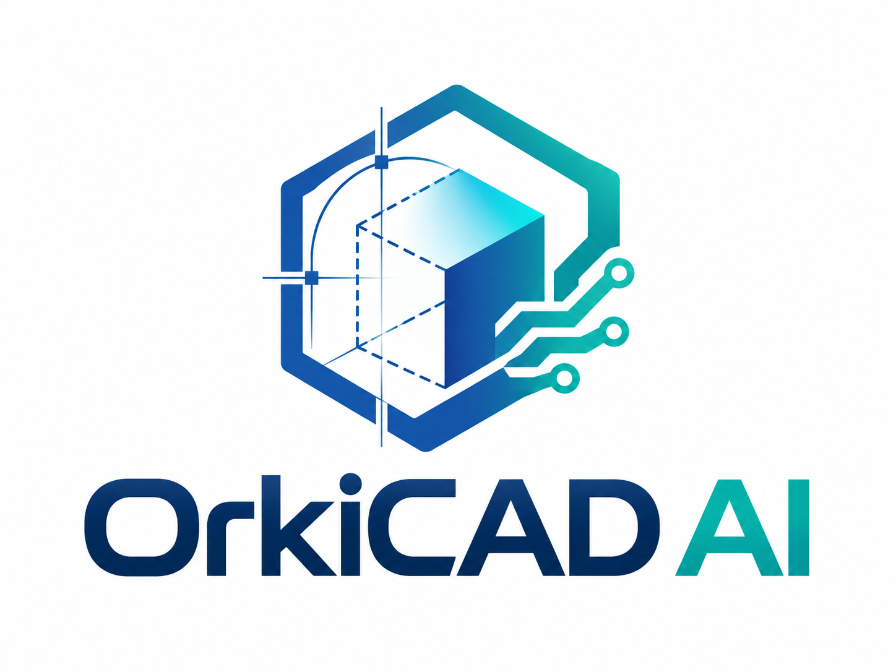

<p align="center">
  
</p>

<p align="center"><strong>Design. Refine. Make.</strong><br>Open-source parametric CAD, powered by AI.</p>

<p align="center">
  <a href="ROADMAP.md"></a>
  <a href="LICENSE"></a>
  
  <a href="https://ko-fi.com/jorgelf"></a>
</p>

<p align="center">
  <a href="#why-orkicad">Why OrkiCAD?</a> ·
  <a href="#current-status">Status</a> ·
  <a href="#quick-start">Quick start</a> ·
  <a href="#product-architecture">Architecture</a> ·
  <a href="#version-roadmap">Roadmap</a> ·
  <a href="#contributing-and-support">Contribute</a> ·
  <a href="#license-and-attribution">License</a>
</p>

# OrkiCAD

Maintained by [jlopfri921](https://github.com/jlopfri921). **OrkiCAD** is an open-source, **local-first CAD workbench** for parametric mechanical design, AI-assisted part specification, technical drawing and digital fabrication. The project aims to make reliable 2D/3D creation approachable without hiding dimensions, assumptions or manufacturing limitations.

> [!IMPORTANT]
> **Early source prototype — not a stable release.** The internal version is **0.0.1** and there is **no official tagged release**, independently installable production Desktop package or secured public Web deployment. Some Windows workflows have been validated by the maintainer; source presence does not imply every platform, adapter or feature is verified. See [Status](docs/STATUS.md) and [Roadmap](ROADMAP.md).

## Why OrkiCAD?

- **Conversational and parametric:** describe an idea, inspect the interpreted dimensions, then refine the editable part specification.
- **CAD first:** deterministic geometry, dimensional validation and transparent assumptions rather than relying on a plausible-looking AI image.
- **Local first:** design manually or use a locally installed Ollama model; cloud providers remain optional and require explicit approval.
- **One core, three clients:** shared Python CAD contracts for Studio Web, Tauri Desktop and optional ComfyUI nodes/workflows.
- **Manufacturing aware:** support inspection and interoperable geometry exports, with practical limits and validation before fabrication.
- **Open and extensible:** collaborate on components, adapters, documentation, UI, tests and interoperable file formats.

## Current status

| Area | Current evidence / scope | Limitations |
| --- | --- | --- |
| **CAD Core** | Source generators and validated parameter schemas for initial shapes including washers, mounting plates, open boxes, screws, nuts and spur gears | Standards, clearances and manufacturing accuracy require further verification |
| **STL / mesh** | Maintainer-confirmed Windows STL outputs and preliminary watertight/volume checks for selected sample parts | Results do not establish mechanical fit or accuracy across all designs |
| **STEP / OCCT** | Maintainer-reported native OCCT STEP workflow in Windows ComfyUI and Studio export source | Clean-install bundles, external interoperability and multi-platform release tests remain pending |
| **Studio Web** | React/TypeScript source with a 3D viewport, parameter/feature editing, local API and export routes | Latest browser end-to-end acceptance and secure hosted deployment remain pending |
| **Studio Desktop** | Tauri 2 developer shell and shared frontend source | No production-grade standalone installer shipped |
| **ComfyUI** | Optional nodes/workflows; maintainer-reported local generation/export tests | Broader compatibility and packaging still under validation |
| **AI** | Local Ollama experiments; cloud-provider adapter architecture | Cloud providers must be individually tested/configured; no universal AI guarantees |
| **Languages & units** | Spanish/English UI and mm/in display code in the prototype | Final usability and round-trip tests pending |

The project distinguishes **planned**, **implemented in source**, **maintainer-verified**, and **released**. Detailed evidence and caveats live in [docs/STATUS.md](docs/STATUS.md).

## What you can build

**Starter parametric families:** washers, mounting plates, open boxes, metric fasteners and spur gears, subject to the active backend and its dependencies.

**Long-term design library (planned):** plates and flanges, fasteners, gears and transmissions, shafts and bushings, supports and structural profiles, enclosures, 3D-printing parts, pipes and connections.

**Expanded workflows (planned, not all working today):**

- Natural-language **text → reviewed CAD parameters → editable solid**.
- **Images, sketches, PDFs and dimensions → reconstructed 2D/3D geometry**, with explicit uncertainty and calibration.
- Orthographic drawing **front/top/side views, sections, dimensions**, and appropriate DXF/SVG/PDF output.
- Geometry selection and feature history for cuts, holes, fillets, chamfers and variants.
- Mesh inspection, repair and splitting for **3D-printing preparation**.
- Compatible organic/visual asset workflows and formats when supported by an appropriate engine.

A generated mesh is **not automatically a valid engineering solid**. Always verify units, tolerances, topology and fit before production.

## Product architecture

| Component | Role | Delivery |
| --- | --- | --- |
| **OrkiCAD Core** | Versioned part specifications, validated CAD generators, geometry and export adapters | Python source prototype |
| **OrkiCAD Studio Web** | React/TypeScript design interface served with a secure CAD backend | Local developer prototype; hosted release pending |
| **OrkiCAD Studio Desktop** | Tauri 2/Rust shell sharing the Studio interface and Core contracts | Developer shell; production installers pending |
| **OrkiCAD ComfyUI** | Optional nodes and reproducible visual workflows | Early source and user-tested workflows |

OrkiCAD prioritizes native **OpenCascade (OCCT)** B-rep/STEP where feasible, alongside **OpenSCAD/BOSL2** source/mesh generation. FreeCAD is an optional integration, **not** a required end-user dependency in the target product. See [Architecture](docs/ARCHITECTURE.md) and [ADR: three clients, one core](docs/adr/0007-three-clients-one-core.md).

### AI and external CAD providers

| Provider | Proposed role | Policy |
| --- | --- | --- |
| **Ollama** | Local text-to-structured-parameters interpretation | Local, configurable, optional |
| **OpenAI / Claude / Gemini** | Cloud interpretation and assistance | Opt-in, user-configured, provider-specific terms |
| **GrandpaCAD API** | Optional third-party CAD/3D generation and import pipeline | **Proposed integration only**; API agreement, technical contract, authentication, costs and permitted use must be confirmed |

**GrandpaCAD is not integrated in this release.** A future adapter must be replaceable, disclose any external data transmission and validate imported results. A generated STEP file does not necessarily contain recoverable feature history. No API keys, private drawings or proprietary model weights are bundled with this repository. See [AI provider strategy](docs/AI_PROVIDERS.md) and [Security](SECURITY.md).

## File formats

| Format | Purpose | Note |
| --- | --- | --- |
| **SCAD** | Parametric source | OpenSCAD/BOSL2 path |
| **STL / 3MF** | Mesh / 3D-print output | Verify backend support and mesh validity |
| **STEP** | B-rep CAD interchange | OCCT export path; end-to-end compatibility still being validated |
| **DXF / SVG / PDF** | Technical sketches and drawings | Planned or backend-dependent |
| **FCStd** | FreeCAD native project | Optional integration, not equivalent to generic STEP |
| **OBJ / GLB / glTF** | Visual meshes and assets | Planned or backend-dependent |

Formats are **not** universally available for every input geometry or provider. Converting a mesh into CAD does not recreate a parametric design history.

## Quick start

The commands below are for **developers running the source prototype**, not a one-click end-user installer.

```powershell
git clone https://github.com/jlopfri921/OrkiCAD.git
cd OrkiCAD
py -3 -m venv .venv
.\.venv\Scripts\python.exe -m pip install -e .
.\.venv\Scripts\python.exe -m unittest discover -s tests -v
.\.venv\Scripts\python.exe -m orkicad_core.cli examples\washer.json -o outputs\washer.scad
```

To render an STL, install a compatible OpenSCAD CLI separately and refer to [Getting started](docs/GETTING_STARTED.md). Fastener/gear rendering also requires [BOSL2 setup](docs/BOSL2_SETUP.md). For the Studio UI, follow [Studio Web developer guide](docs/STUDIO_PROTOTYPE.md), [Desktop developer guide](docs/STUDIO_DESKTOP.md), and [Local development](docs/LOCAL_DEVELOPMENT.md). **Do not expose a development API to the public Internet.**

### Screenshots and demo

An up-to-date, verified Studio screenshot and demo will be added after browser acceptance. The logo shown above is the [project's existing brand asset](docs/BRANDING.md), not a claim that the planned UI redesign is already shipped.

## Version roadmap

Version labels describe **proposed milestones**, not released features. The canonical plan remains [ROADMAP.md](ROADMAP.md); a revised UX/provider-focused plan can be reconciled there without discarding existing technical requirements.

| Milestone | Intended focus | Status |
| --- | --- | --- |
| **0.0.1** | Core/Studio/ComfyUI early source prototype | Internal development, no tagged release |
| **0.1.x** | Stabilize core + minimal Studio UX foundation | Planned / acceptance pending |
| **0.2.x** | Improved projects, editor, parameters and navigation | Planned |
| **0.3.x** | Optional external-provider architecture and GrandpaCAD feasibility | Proposed; external agreement required |
| **0.4–0.8** | AI adapters, CAD features, reconstruction, fabrication, packaging | Planned |
| **0.9** | Beta, compatibility, security and usability | Planned |
| **1.0** | Supported, documented stable subset with real release evidence | Planned |

**No release date or stability is implied by this table.** Consult [Changelog](CHANGELOG.md), [Versioning](docs/VERSIONING.md) and [Status](docs/STATUS.md).

## Documentation

| Document | Description |
| --- | --- |
| [Getting started](docs/GETTING_STARTED.md) | Install and run the early CAD Core |
| [Studio Web](docs/STUDIO_PROTOTYPE.md) · [Studio Desktop](docs/STUDIO_DESKTOP.md) | Developer setup and current limitations |
| [Architecture](docs/ARCHITECTURE.md) · [Requirements](docs/REQUIREMENTS.md) | Product contracts and boundaries |
| [Vision and workflows](docs/VISION_AND_WORKFLOWS.md) · [Workflow catalog](docs/WORKFLOW_CATALOG.md) | Intended multimodal experience |
| [ComfyUI integration](docs/COMFYUI_INTEGRATION.md) | Optional node/workflow integration |
| [AI providers](docs/AI_PROVIDERS.md) · [Security](SECURITY.md) | Provider and operational safeguards |
| [I18N](docs/I18N.md) · [Branding](docs/BRANDING.md) | Languages, units and visual identity |
| [Roadmap](ROADMAP.md) · [Changelog](CHANGELOG.md) · [Status](docs/STATUS.md) | Plans versus verified progress |
| [Third-party notices](THIRD_PARTY_NOTICES.md) | External dependencies and their separate terms |

## Contributing and support

OrkiCAD welcomes contributions to **CAD algorithms, test fixtures, parametric libraries, accessibility, translations, documentation, platform packaging and AI adapters**. Read [CONTRIBUTING.md](CONTRIBUTING.md) before proposing a change, and report security issues using [SECURITY.md](SECURITY.md).

Support independent development through [Ko-fi](https://ko-fi.com/jorgelf). Donations are **voluntary**, do not unlock basic CAD capabilities, and are not a substitute for paid third-party API credits. Sponsorship does not confer control over the project's technical decisions.

## License and attribution

**OrkiCAD source code is licensed under the [Apache License, Version 2.0](LICENSE)** (SPDX: `Apache-2.0`).

Copyright © 2026 Jorge López Frías and contributors, for contributions they own.

Third-party libraries, model weights, design files, fonts and brands may have **different licenses or usage terms**. See [THIRD_PARTY_NOTICES.md](THIRD_PARTY_NOTICES.md). The Apache 2.0 software license does not grant rights to external provider trademarks, private APIs or third-party assets.

---

<p align="center"><strong>OrkiCAD — Design. Refine. Make.</strong><br>Open CAD, practical AI, and community-driven engineering.</p>
